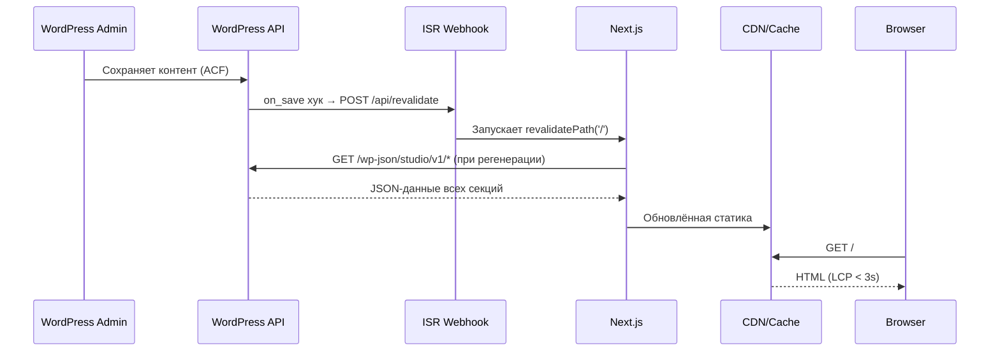

# Технический дизайн: Headless WordPress тема веб-студии

## Обзор

Проект реализует архитектуру Headless CMS: WordPress выступает исключительно как бэкенд (контент-хранилище + REST API), а Next.js 14+ — как фронтенд с SSG/ISR/SSR. Весь контент всех секций лендинга управляется через WordPress Admin с помощью ACF. Данные передаются через кастомный REST API (`/wp-json/studio/v1/`). Фронтенд использует только Axios для HTTP-запросов, Framer Motion или GSAP для анимаций, Tailwind CSS для стилизации.

### Ключевые архитектурные решения

- **REST API вместо GraphQL** как основной транспорт — меньше сложности, достаточно для лендинга с фиксированной структурой
- **ISR (Incremental Static Regeneration)** для главной страницы — баланс между производительностью и актуальностью контента
- **Webhook-механизм** для принудительной регенерации при сохранении в WordPress Admin
- **Axios как единственный HTTP-клиент** — унифицированные интерцепторы, retry-логика, типизация

---

## Архитектура

### Высокоуровневая схема взаимодействия

```
┌─────────────────────────────────────────────────────────────────────┐
│                        WordPress (Backend)                          │
│                                                                     │
│  ┌──────────────┐   ┌──────────────┐   ┌──────────────────────┐   │
│  │  WordPress   │   │ Custom REST  │   │  ACF / Custom Meta   │   │
│  │  Admin CMS   │──▶│  API Plugin  │   │  Fields (Content)    │   │
│  └──────────────┘   └──────┬───────┘   └──────────────────────┘   │
│          │                 │                      │                 │
│          │ on_save hook    │ /wp-json/studio/v1/* │ reads           │
│          ▼                 │                      │                 │
│  ┌──────────────┐         │                      │                 │
│  │ ISR Webhook  │─────────┼──────────────────────┘                 │
│  │  Trigger     │         │                                         │
│  └──────┬───────┘         │                                         │
│         │                 │                                         │
└─────────┼─────────────────┼─────────────────────────────────────────┘
          │ POST /api/revalidate  │ GET endpoints
          ▼                 ▼
┌─────────────────────────────────────────────────────────────────────┐
│                      Next.js (Frontend)                             │
│                                                                     │
│  ┌──────────────┐   ┌──────────────┐   ┌──────────────────────┐   │
│  │  App Router  │   │  Axios       │   │  React Components    │   │
│  │  (SSG/ISR)   │   │  HTTP Client │   │  (Framer Motion /    │   │
│  │              │   │              │   │   GSAP animations)   │   │
│  └──────────────┘   └──────────────┘   └──────────────────────┘   │
│          │                                                          │
│  ┌──────────────────────────────────────────────────────────────┐  │
│  │  Pages: / (SSG+ISR)  |  /portfolio/[slug] (ISR)             │  │
│  │         /api/revalidate (webhook handler)                    │  │
│  └──────────────────────────────────────────────────────────────┘  │
└─────────────────────────────────────────────────────────────────────┘
          │
          ▼ HTML (SSR/SSG)
┌─────────────────┐
│   CDN / Vercel  │──▶ Browser (User)
└─────────────────┘
```

### Mermaid-диаграмма потока данных



---

## Компоненты и интерфейсы

### Структура WordPress-темы

```
wp-content/themes/studio-headless/
├── functions.php               # Регистрация хуков, типов записей, REST API
├── style.css                   # Заголовок темы (метаданные)
├── index.php                   # Минимальный шаблон (redirect на Next.js)
├── includes/
│   ├── post-types.php          # Регистрация CPT: portfolio, technologies, team, services, geography
│   ├── acf-fields.php          # Регистрация ACF-групп полей для каждого CPT и секций
│   ├── rest-api.php            # Регистрация всех кастомных REST-эндпоинтов
│   ├── cors.php                # Настройка CORS-заголовков
│   ├── isr-webhook.php         # WordPress хук on_save → POST в Next.js /api/revalidate
│   ├── contact-handler.php     # Обработка заявок из контактной формы
│   └── admin-settings.php      # Страница настроек темы в WordPress Admin
├── demo-data/
│   ├── demo-import.php         # WP-CLI скрипт / плагин импорта демо-данных
│   └── demo-content.json       # JSON с демо-контентом всех секций
├── .env.example                # Пример переменных окружения (для документации)
└── README.md                   # Инструкция по установке
```

### Структура Next.js-приложения

```
nextjs-frontend/
├── app/
│   ├── layout.tsx              # Root layout: метаданные, шрифты, провайдеры
│   ├── page.tsx                # Главная страница лендинга (SSG + ISR)
│   ├── portfolio/
│   │   └── [slug]/
│   │       └── page.tsx        # Страница проекта (ISR)
│   ├── api/
│   │   └── revalidate/
│   │       └── route.ts        # Webhook-обработчик ISR-регенерации
│   ├── sitemap.ts              # Генератор sitemap.xml
│   └── robots.ts               # Генератор robots.txt
├── components/
│   ├── sections/
│   │   ├── HeroSection.tsx
│   │   ├── AboutSection.tsx
│   │   ├── ServicesSection.tsx
│   │   ├── TechnologiesSection.tsx
│   │   ├── PortfolioSection.tsx
│   │   ├── GeographySection.tsx
│   │   └── ContactSection.tsx
│   ├── ui/
│   │   ├── AnimatedCounter.tsx # Счётчик с анимацией числовых показателей
│   │   ├── Carousel.tsx        # Карусель портфолио
│   │   ├── ContactForm.tsx     # Форма обратной связи с валидацией
│   │   ├── CustomCursor.tsx    # Кастомный курсор (десктоп)
│   │   ├── MapEmbed.tsx        # Google Maps / Leaflet embed
│   │   ├── Modal.tsx           # Модальное окно для деталей проекта
│   │   ├── ServiceCard.tsx
│   │   ├── TeamCard.tsx
│   │   └── TechCard.tsx
│   └── layout/
│       ├── Header.tsx
│       └── Footer.tsx
├── lib/
│   ├── api/
│   │   ├── axios-client.ts     # Настройка Axios-экземпляра
│   │   └── endpoints.ts        # Функции-обёртки для каждого эндпоинта
│   ├── hooks/
│   │   ├── useScrollAnimation.ts
│   │   └── useReducedMotion.ts
│   └── utils/
│       ├── jsonld.ts           # Генераторы JSON-LD схем
│       └── seo.ts              # Утилиты для метаданных
├── types/
│   └── api.ts                  # TypeScript-интерфейсы для всех API-ответов
├── public/
│   └── fallback/               # Статичный fallback-контент (если API недоступен)
├── .env.example
├── next.config.ts
└── tailwind.config.ts
```

---

## Модели данных

### TypeScript-интерфейсы API-ответов

```typescript
// types/api.ts

// ─── Глобальные настройки ───────────────────────────────────────────────────

export interface SiteSettings {
  site_name: string;
  site_description: string;
  logo_url: string;
  favicon_url: string;
  email: string;
  phone: string;
  address: string;
  social_links: SocialLink[];
  seo: SeoMeta;
  map_coordinates: { lat: number; lng: number };
  office_marker_label: string;
}

export interface SocialLink {
  platform: 'telegram' | 'instagram' | 'linkedin' | 'github' | 'behance' | string;
  url: string;
  label: string;
}

export interface SeoMeta {
  title: string;
  description: string;
  og_image_url: string;
  og_type: string;
  twitter_card: 'summary' | 'summary_large_image';
}

// ─── Hero-секция ─────────────────────────────────────────────────────────────

export interface HeroSection {
  heading: string;
  subheading: string;
  cta_text: string;
  cta_anchor: string; // '#contact' | '#portfolio' и т.д.
  background_type: 'video' | 'image' | 'gradient';
  background_video_url?: string;
  background_image_url?: string;
  background_gradient?: string;  // CSS gradient string
}

// ─── Секция «О нас» ──────────────────────────────────────────────────────────

export interface AboutSection {
  title: string;
  history: string;       // HTML-контент или plain text
  mission: string;
  values: string[];
  stats: AboutStat[];
}

export interface AboutStat {
  label: string;         // «лет на рынке», «проектов», «клиентов»
  value: number;
  suffix?: string;       // «+», «%» и т.д.
}

// ─── Команда ─────────────────────────────────────────────────────────────────

export interface TeamMember {
  id: number;
  name: string;
  position: string;
  photo_url: string;
  photo_alt: string;
  sort_order: number;
}

// ─── Услуги ──────────────────────────────────────────────────────────────────

export interface Service {
  id: number;
  title: string;
  description: string;
  icon_url: string;
  icon_alt: string;
  sort_order: number;
  is_visible: boolean;
}

// ─── Технологии ──────────────────────────────────────────────────────────────

export interface Technology {
  id: number;
  name: string;
  logo_url: string;
  logo_alt: string;
  category: TechCategory;
  sort_order: number;
  is_visible: boolean;
}

export type TechCategory = 'Frontend' | 'Backend' | 'CMS' | 'DevOps' | 'Mobile' | string;

export interface TechnologiesSection {
  categories: TechCategory[];
  items: Technology[];
}

// ─── Портфолио ───────────────────────────────────────────────────────────────

export interface PortfolioProject {
  id: number;
  slug: string;
  title: string;
  short_description: string;
  full_description: string;
  screenshot_url: string;
  screenshot_alt: string;
  gallery: { url: string; alt: string }[];
  technologies: string[];       // Названия технологий
  project_url?: string;         // Внешняя ссылка на проект
  sort_order: number;
  is_visible: boolean;
  published_at: string;         // ISO 8601
}

// ─── География ───────────────────────────────────────────────────────────────

export interface GeographySection {
  title: string;
  description: string;
  countries: CountryData[];
}

export interface CountryData {
  id: number;
  country_code: string;        // ISO 3166-1 alpha-2 (RU, DE, US...)
  country_name: string;
  projects_count: number;
  clients_count: number;
  tooltip_text: string;
}

// ─── Контакты (входящая заявка) ───────────────────────────────────────────────

export interface ContactFormPayload {
  name: string;
  email: string;
  phone: string;
  project_description: string;
}

export interface ContactFormResponse {
  success: boolean;
  message: string;
}

// ─── Общие API-обёртки ───────────────────────────────────────────────────────

export interface ApiError {
  code: string;
  message: string;
  data?: {
    status: number;
    validation_errors?: Record<string, string[]>;
  };
}

// ─── Агрегированный ответ для главной страницы ───────────────────────────────
// (загружается параллельно через Promise.all в generateStaticParams)

export interface LandingPageData {
  settings: SiteSettings;
  hero: HeroSection;
  about: AboutSection;
  team: TeamMember[];
  services: Service[];
  technologies: TechnologiesSection;
  portfolio: PortfolioProject[];
  geography: GeographySection;
}
```

### REST API эндпоинты

| Метод | Путь | Стратегия кеша | Описание |
|-------|------|----------------|----------|
| GET | `/wp-json/studio/v1/settings` | ISR 3600s | Глобальные настройки |
| GET | `/wp-json/studio/v1/hero` | ISR 3600s | Hero-секция |
| GET | `/wp-json/studio/v1/about` | ISR 3600s | О нас + команда |
| GET | `/wp-json/studio/v1/services` | ISR 3600s | Услуги |
| GET | `/wp-json/studio/v1/portfolio` | ISR 1800s | Портфолио |
| GET | `/wp-json/studio/v1/technologies` | ISR 3600s | Технологии |
| GET | `/wp-json/studio/v1/team` | ISR 3600s | Команда |
| GET | `/wp-json/studio/v1/geography` | ISR 3600s | География |
| POST | `/wp-json/studio/v1/contact` | no-cache | Отправка заявки |

### Настройка Axios-клиента

```typescript
// lib/api/axios-client.ts

import axios, { AxiosInstance, AxiosError, InternalAxiosRequestConfig } from 'axios';

const RETRY_LIMIT = 3;
const RETRY_DELAY_BASE_MS = 500;

// Вспомогательная функция экспоненциальной задержки
const sleep = (ms: number) => new Promise(resolve => setTimeout(resolve, ms));

// Создаём единственный экземпляр клиента
export const apiClient: AxiosInstance = axios.create({
  baseURL: process.env.NEXT_PUBLIC_API_URL, // https://cms.studio.ru/wp-json/studio/v1
  timeout: 10_000,
  headers: {
    'Content-Type': 'application/json',
    Accept: 'application/json',
  },
});

// Интерцептор запросов: добавление заголовков авторизации при необходимости
apiClient.interceptors.request.use(
  (config: InternalAxiosRequestConfig) => {
    // Для защищённых эндпоинтов (revalidate webhook) заголовок добавляется отдельно
    return config;
  },
  (error) => Promise.reject(error)
);

// Интерцептор ответов: централизованная обработка ошибок + retry для 5xx
apiClient.interceptors.response.use(
  (response) => response,
  async (error: AxiosError) => {
    const config = error.config as InternalAxiosRequestConfig & { _retryCount?: number };
    
    if (!config || !error.response) return Promise.reject(error);

    // Retry только для 5xx ошибок
    if (error.response.status >= 500) {
      config._retryCount = config._retryCount ?? 0;
      
      if (config._retryCount < RETRY_LIMIT) {
        config._retryCount += 1;
        const delay = RETRY_DELAY_BASE_MS * Math.pow(2, config._retryCount - 1);
        await sleep(delay);
        return apiClient(config);
      }
    }

    return Promise.reject(error);
  }
);

// Функции-обёртки с типизацией ответов
// lib/api/endpoints.ts

import { apiClient } from './axios-client';
import type {
  SiteSettings, HeroSection, AboutSection, TeamMember,
  Service, TechnologiesSection, PortfolioProject, GeographySection,
  ContactFormPayload, ContactFormResponse, LandingPageData
} from '@/types/api';

export const fetchSettings = () =>
  apiClient.get<SiteSettings>('/settings').then(r => r.data);

export const fetchHero = () =>
  apiClient.get<HeroSection>('/hero').then(r => r.data);

export const fetchAbout = () =>
  apiClient.get<AboutSection>('/about').then(r => r.data);

export const fetchTeam = () =>
  apiClient.get<TeamMember[]>('/team').then(r => r.data);

export const fetchServices = () =>
  apiClient.get<Service[]>('/services').then(r => r.data);

export const fetchTechnologies = () =>
  apiClient.get<TechnologiesSection>('/technologies').then(r => r.data);

export const fetchPortfolio = () =>
  apiClient.get<PortfolioProject[]>('/portfolio').then(r => r.data);

export const fetchGeography = () =>
  apiClient.get<GeographySection>('/geography').then(r => r.data);

export const submitContact = (payload: ContactFormPayload) =>
  apiClient.post<ContactFormResponse>('/contact', payload).then(r => r.data);

// Агрегированная загрузка всех данных лендинга
export const fetchLandingPageData = async (): Promise<LandingPageData> => {
  const [settings, hero, about, team, services, technologies, portfolio, geography] =
    await Promise.all([
      fetchSettings(),
      fetchHero(),
      fetchAbout(),
      fetchTeam(),
      fetchServices(),
      fetchTechnologies(),
      fetchPortfolio(),
      fetchGeography(),
    ]);
  return { settings, hero, about, team, services, technologies, portfolio, geography };
};
```

### Next.js роутинг и стратегии рендеринга

```typescript
// app/page.tsx — Главная страница (SSG + ISR)

import { fetchLandingPageData } from '@/lib/api/endpoints';

// revalidate = 3600 означает: ISR регенерирует страницу не чаще раза в час.
// При изменении контента в WordPress Admin webhook вызывает /api/revalidate,
// что запускает немедленную on-demand регенерацию.
export const revalidate = 3600;

export default async function HomePage() {
  let data;
  try {
    data = await fetchLandingPageData();
  } catch {
    // Fallback: отображаем статичный резервный контент
    return <FallbackPage />;
  }
  return <LandingLayout data={data} />;
}
```

```typescript
// app/portfolio/[slug]/page.tsx — Страница проекта (ISR)

export const revalidate = 1800; // 30 минут

export async function generateStaticParams() {
  const projects = await fetchPortfolio();
  return projects.map(p => ({ slug: p.slug }));
}
```

```typescript
// app/api/revalidate/route.ts — ISR Webhook-обработчик

import { revalidatePath } from 'next/cache';
import { NextRequest, NextResponse } from 'next/server';

export async function POST(request: NextRequest) {
  const secret = request.headers.get('x-revalidate-secret');
  
  // Проверка секрета для защиты от несанкционированных вызовов
  if (secret !== process.env.REVALIDATE_SECRET) {
    return NextResponse.json({ error: 'Unauthorized' }, { status: 401 });
  }

  const body = await request.json() as { paths?: string[] };
  const paths = body.paths ?? ['/'];

  paths.forEach(path => revalidatePath(path));

  return NextResponse.json({ revalidated: true, paths });
}
```

### ISR Webhook в WordPress (PHP)

```php
// includes/isr-webhook.php

/**
 * Инициирует ISR-регенерацию Next.js при сохранении любого поста или опции темы.
 * Использует wp_remote_post для отправки POST-запроса на Next.js /api/revalidate.
 */

// Хук при сохранении записей (portfolio, services, team, technologies, geography)
add_action('save_post', 'studio_trigger_isr_revalidate', 10, 2);

function studio_trigger_isr_revalidate(int $post_id, WP_Post $post): void {
    // Игнорируем автосохранения и ревизии
    if (wp_is_post_autosave($post_id) || wp_is_post_revision($post_id)) {
        return;
    }

    $next_url  = defined('NEXTJS_FRONTEND_URL') ? NEXTJS_FRONTEND_URL : '';
    $secret    = defined('NEXTJS_REVALIDATE_SECRET') ? NEXTJS_REVALIDATE_SECRET : '';

    if (empty($next_url) || empty($secret)) {
        return;
    }

    $paths = ['/'];
    if ($post->post_type === 'portfolio') {
        $paths[] = '/portfolio/' . $post->post_name;
    }

    wp_remote_post(
        trailingslashit($next_url) . 'api/revalidate',
        [
            'method'  => 'POST',
            'headers' => [
                'Content-Type'         => 'application/json',
                'x-revalidate-secret'  => $secret,
            ],
            'body'    => wp_json_encode(['paths' => $paths]),
            'timeout' => 5,
        ]
    );
}

// Также триггерим при сохранении настроек темы (ACF options page)
add_action('acf/save_post', function ($post_id) {
    if ($post_id === 'options') {
        studio_trigger_isr_revalidate(0, (object)['post_type' => 'options', 'post_name' => '']);
    }
});
```

---

## Архитектура анимаций

### Стратегия: Framer Motion (основной) + GSAP ScrollTrigger (опциональный)

Проект использует **Framer Motion** как основную библиотеку анимаций (нативная интеграция с React, декларативный API). GSAP ScrollTrigger применяется только для сложных timeline-анимаций (Hero parallax, Geography map reveal), если потребуется более тонкий контроль.

```typescript
// lib/hooks/useReducedMotion.ts

import { useEffect, useState } from 'react';

export function useReducedMotion(): boolean {
  const [reduced, setReduced] = useState(false);
  
  useEffect(() => {
    const mq = window.matchMedia('(prefers-reduced-motion: reduce)');
    setReduced(mq.matches);
    const handler = (e: MediaQueryListEvent) => setReduced(e.matches);
    mq.addEventListener('change', handler);
    return () => mq.removeEventListener('change', handler);
  }, []);
  
  return reduced;
}
```

```typescript
// Пример scroll-triggered анимации секции (Framer Motion)
// components/sections/ServicesSection.tsx (фрагмент)

const cardVariants = {
  hidden: { opacity: 0, y: 40 },
  visible: (i: number) => ({
    opacity: 1,
    y: 0,
    transition: { duration: 0.5, delay: i * 0.1, ease: 'easeOut' },
  }),
};

// В компоненте:
const reducedMotion = useReducedMotion();

<motion.div
  variants={reducedMotion ? {} : cardVariants}
  initial="hidden"
  whileInView="visible"
  viewport={{ once: true, margin: '-80px' }}
  custom={index}
>
  <ServiceCard service={service} />
</motion.div>
```

### Карта анимаций по секциям

| Секция | Библиотека | Тип анимации | Триггер |
|--------|-----------|--------------|---------|
| Hero | Framer Motion | Fade-in + slide-up заголовка, CTA | On mount, delay 0ms |
| О нас | Framer Motion | Stagger карточек команды (100ms) | Viewport enter |
| О нас — счётчик | Framer Motion + JS | Числовой count-up | Viewport enter |
| Услуги | Framer Motion | Stagger карточек + hover scale | Viewport + hover |
| Технологии | Framer Motion | Fade-in по сетке | Viewport enter |
| Портфолио | Framer Motion | Slide карусели | Interaction |
| География | Framer Motion / GSAP | Fade-in карты + пинов | Viewport enter |
| Контакты | Framer Motion | Slide-in формы | Viewport enter |

---

## SEO-стратегия

```typescript
// app/layout.tsx — базовые метаданные

import type { Metadata } from 'next';
import { fetchSettings } from '@/lib/api/endpoints';

export async function generateMetadata(): Promise<Metadata> {
  const settings = await fetchSettings();
  return {
    title: { default: settings.site_name, template: `%s | ${settings.site_name}` },
    description: settings.seo.description,
    openGraph: {
      title: settings.seo.title,
      description: settings.seo.description,
      images: [{ url: settings.seo.og_image_url }],
      type: 'website',
    },
    twitter: {
      card: settings.seo.twitter_card,
      title: settings.seo.title,
      description: settings.seo.description,
      images: [settings.seo.og_image_url],
    },
    robots: { index: true, follow: true },
  };
}
```

```typescript
// app/sitemap.ts

import { fetchPortfolio } from '@/lib/api/endpoints';
import type { MetadataRoute } from 'next';

export default async function sitemap(): Promise<MetadataRoute.Sitemap> {
  const portfolio = await fetchPortfolio();
  const base = process.env.NEXT_PUBLIC_SITE_URL!;

  const projectUrls = portfolio.map(p => ({
    url: `${base}/portfolio/${p.slug}`,
    lastModified: new Date(p.published_at),
    changeFrequency: 'monthly' as const,
    priority: 0.7,
  }));

  return [
    { url: base, lastModified: new Date(), changeFrequency: 'weekly', priority: 1.0 },
    ...projectUrls,
  ];
}
```

```typescript
// lib/utils/jsonld.ts — JSON-LD для главной страницы

import type { SiteSettings } from '@/types/api';

export function buildOrganizationJsonLd(settings: SiteSettings) {
  return {
    '@context': 'https://schema.org',
    '@type': 'Organization',
    name: settings.site_name,
    description: settings.seo.description,
    url: process.env.NEXT_PUBLIC_SITE_URL,
    logo: settings.logo_url,
    contactPoint: {
      '@type': 'ContactPoint',
      telephone: settings.phone,
      email: settings.email,
      contactType: 'customer support',
    },
    sameAs: settings.social_links.map(l => l.url),
  };
}

export function buildWebSiteJsonLd(settings: SiteSettings) {
  return {
    '@context': 'https://schema.org',
    '@type': 'WebSite',
    name: settings.site_name,
    url: process.env.NEXT_PUBLIC_SITE_URL,
  };
}
```

---

## Обработка ошибок

### Стратегия уровней

| Уровень | Механизм | Поведение |
|---------|----------|-----------|
| HTTP 4xx (валидация) | Axios interceptor | Парсинг `data.validation_errors`, прокидывается в форму |
| HTTP 5xx | Axios interceptor + retry | 3 попытки с экспоненциальной задержкой (500ms, 1s, 2s) |
| Таймаут (10s) | Axios timeout | Отображение fallback-контента |
| API недоступен (SSG) | try/catch в `page.tsx` | Рендер статичной fallback-страницы |
| Ошибка гидратации | React Error Boundary | Сообщение об ошибке с кнопкой перезагрузки |
| ISR Webhook fail | WordPress `wp_remote_post` | Логирование в WP error log, ISR продолжает работать по таймеру |

```typescript
// Обработка ошибок валидации контактной формы (фрагмент)

try {
  await submitContact(formData);
  setStatus('success');
  reset();
} catch (err) {
  if (axios.isAxiosError(err) && err.response?.status === 422) {
    const apiError = err.response.data as ApiError;
    const validationErrors = apiError.data?.validation_errors ?? {};
    // Устанавливаем ошибки в react-hook-form
    Object.entries(validationErrors).forEach(([field, messages]) => {
      setError(field as keyof ContactFormPayload, { message: messages[0] });
    });
  } else {
    setStatus('error');
  }
}
```

---

## Стратегия тестирования

Проект использует двойной подход: **юнит-тесты** для конкретных примеров и граничных случаев, **property-based тесты** для универсальных свойств на широком диапазоне входных данных.

Стек тестирования:
- **Vitest** — тест-раннер (совместим с Next.js 14+)
- **fast-check** — property-based тестирование (TypeScript-совместимый, активно поддерживается)
- **React Testing Library** — тестирование React-компонентов
- **MSW (Mock Service Worker)** — мокирование API в тестах

Каждый property-тест должен запускаться с минимум **100 итерациями**.

Тег для каждого теста: `Feature: headless-wordpress-theme, Property {N}: {описание}`


---

## Correctness Properties

*Свойство (property) — характеристика или поведение системы, которое должно выполняться для всех допустимых входных данных. Это формальное утверждение о том, что система должна делать. Свойства служат мостом между читаемыми человеком спецификациями и машинно-верифицируемыми гарантиями корректности.*

Все свойства ниже получены из критериев приёмки методом property-based тестирования (библиотека **fast-check**). Каждый тест запускается минимум с **100 итерациями**.

---

### Property 1: Успешная отправка контактной формы

*Для любого* объекта `ContactFormPayload` с непустыми полями `name`, валидным `email` и непустым `project_description`, POST-запрос на `/studio/v1/contact` должен возвращать `{ success: true }`.

**Validates: Requirements 2.9**

---

### Property 2: Невалидные данные формы возвращают HTTP 422

*Для любого* объекта `ContactFormPayload`, в котором хотя бы одно обязательное поле (`name`, `email`) пустое или `email` имеет неверный формат, API должен возвращать HTTP-статус 422 с описанием ошибки валидации.

**Validates: Requirements 2.10**

---

### Property 3: generateMetadata содержит все обязательные поля

*Для любого* объекта `SiteSettings` с ненулевыми полями `site_name`, `seo.title`, `seo.description`, `seo.og_image_url`, функция `generateMetadata()` должна возвращать объект, содержащий непустые `title`, `description`, `openGraph.title`, `openGraph.description`, `twitter.title`.

**Validates: Requirements 4.1**

---

### Property 4: sitemap содержит запись для каждого проекта

*Для любого* массива `PortfolioProject[]` длиной ≥ 1, функция `sitemap()` должна возвращать массив, содержащий запись с `url` для каждого проекта из входного массива, где `url` соответствует шаблону `${SITE_URL}/portfolio/${project.slug}`.

**Validates: Requirements 4.2**

---

### Property 5: alt-атрибуты изображений соответствуют данным API

*Для любого* объекта данных секции (TeamMember, Service, Technology, PortfolioProject), содержащего поле `*_alt`, React-компонент при рендеринге должен устанавливать атрибут `alt` изображения равным этому полю.

**Validates: Requirements 4.5**

---

### Property 6: buildOrganizationJsonLd возвращает корректный JSON-LD

*Для любого* объекта `SiteSettings`, функция `buildOrganizationJsonLd()` должна возвращать объект со следующими полями: `@context` равным `'https://schema.org'`, `@type` равным `'Organization'`, непустыми `name`, `url`, `logo`, `contactPoint`.

**Validates: Requirements 4.6**

---

### Property 7: Сортировка элементов по sort_order

*Для любого* массива элементов (Service[], Technology[], PortfolioProject[], TeamMember[]) с произвольными значениями поля `sort_order`, функция сортировки должна возвращать массив, упорядоченный по возрастанию `sort_order`.

**Validates: Requirements 5.4**

---

### Property 8: Невидимые элементы исключаются из рендера

*Для любого* массива элементов с полем `is_visible`, функция фильтрации (и/или API) должна возвращать массив, не содержащий ни одного элемента, у которого `is_visible === false`.

**Validates: Requirements 5.5**

---

### Property 9: Axios-клиент добавляет Content-Type заголовок

*Для любого* HTTP-запроса, отправленного через `apiClient`, заголовок `Content-Type` должен иметь значение `'application/json'`.

**Validates: Requirements 6.3**

---

### Property 10: Retry при 5xx ответе не более 3 раз

*Для любого* HTTP-запроса через `apiClient`, при котором сервер стабильно возвращает 5xx-ответ, клиент должен выполнять не более 3 повторных попыток, и суммарное число попыток (включая первую) должно быть ≤ 4.

**Validates: Requirements 6.4, 6.5**

---

### Property 11: Компоненты секций рендерят все обязательные поля из API

*Для любого* объекта данных секции лендинга (HeroSection, AboutSection, TeamMember[], Service[], Technology[], PortfolioProject, GeographySection, SiteSettings), соответствующий React-компонент при рендеринге должен содержать в DOM все обязательные текстовые поля из переданных данных.

Охватывает: HeroSection (heading, subheading, cta_text), AboutSection (title, mission), TeamMember (name, position), Service (title, description), Technology (name), PortfolioProject (title, short_description), CountryData (country_name, projects_count), SiteSettings (phone, email, address).

**Validates: Requirements 7.1, 8.1, 8.2, 9.1, 10.1, 11.4, 12.2, 13.7**

---

### Property 12: Группировка технологий по категориям

*Для любого* массива `Technology[]` с произвольным набором категорий, функция группировки должна:
1. Создавать ровно столько групп, сколько уникальных значений `category` в массиве.
2. Помещать каждый элемент в группу с ключом, равным `element.category`.
3. Не создавать пустых групп.

**Validates: Requirements 10.3**

---

### Property 13: Ошибки валидации API отображаются у соответствующих полей

*Для любого* объекта `validation_errors` из ответа с HTTP 422 (где ключи — имена полей формы, значения — массивы строк ошибок), React-компонент ContactForm должен показывать сообщение об ошибке, совпадающее с первым элементом массива, рядом с соответствующим полем формы.

**Validates: Requirements 13.4**

---

### Property 14: Клиентская валидация email отклоняет невалидные адреса

*Для любой* строки, не соответствующей формату RFC 5322 (включая пустые строки, строки без `@`, строки с пробелами), функция валидации `email` поля формы должна возвращать ошибку (не `undefined`/`null`/`true`).

**Validates: Requirements 13.6**

---

### Property 15: prefers-reduced-motion отключает анимации

*Для любого* компонента секции лендинга при значении `useReducedMotion() === true`, объект `variants`, передаваемый в `motion.*`, должен быть пустым (`{}`), либо свойство `transition.duration` должно равняться 0.

**Validates: Requirements 14.4**

---

## Схема демо-данных для импорта

```json
{
  "settings": {
    "site_name": "WebStudio",
    "site_description": "Создаём сайты и веб-приложения для бизнеса",
    "logo_url": "/wp-content/uploads/logo.svg",
    "email": "hello@webstudio.ru",
    "phone": "+7 (999) 123-45-67",
    "address": "Москва, ул. Примерная, 1",
    "social_links": [
      { "platform": "telegram", "url": "https://t.me/webstudio", "label": "Telegram" },
      { "platform": "behance", "url": "https://behance.net/webstudio", "label": "Behance" }
    ],
    "map_coordinates": { "lat": 55.7558, "lng": 37.6176 },
    "office_marker_label": "WebStudio офис"
  },
  "hero": {
    "heading": "Создаём сайты, которые продают",
    "subheading": "Разработка веб-приложений и лендингов для малого и среднего бизнеса",
    "cta_text": "Обсудить проект",
    "cta_anchor": "#contact",
    "background_type": "gradient",
    "background_gradient": "linear-gradient(135deg, #0f0c29, #302b63, #24243e)"
  },
  "about": {
    "title": "О нас",
    "history": "Работаем с 2015 года. За это время реализовали более 120 проектов.",
    "mission": "Помогать бизнесу расти через качественный веб.",
    "values": ["Качество", "Прозрачность", "Результат"],
    "stats": [
      { "label": "лет на рынке", "value": 9 },
      { "label": "проектов", "value": 120, "suffix": "+" },
      { "label": "постоянных клиентов", "value": 47 }
    ]
  },
  "services": [
    { "id": 1, "title": "Лендинги", "description": "Конверсионные одностраничные сайты", "icon_url": "/icons/landing.svg", "icon_alt": "Лендинг", "sort_order": 1, "is_visible": true },
    { "id": 2, "title": "Корпоративные сайты", "description": "Многостраничные сайты компаний", "icon_url": "/icons/corporate.svg", "icon_alt": "Корпоративный сайт", "sort_order": 2, "is_visible": true },
    { "id": 3, "title": "Интернет-магазины", "description": "WooCommerce и кастомные решения", "icon_url": "/icons/shop.svg", "icon_alt": "Интернет-магазин", "sort_order": 3, "is_visible": true },
    { "id": 4, "title": "Веб-приложения", "description": "React / Next.js SPA и SSR приложения", "icon_url": "/icons/webapp.svg", "icon_alt": "Веб-приложение", "sort_order": 4, "is_visible": true },
    { "id": 5, "title": "SEO-оптимизация", "description": "Техническое SEO и контентная стратегия", "icon_url": "/icons/seo.svg", "icon_alt": "SEO", "sort_order": 5, "is_visible": true },
    { "id": 6, "title": "Поддержка", "description": "Техническое сопровождение и обновления", "icon_url": "/icons/support.svg", "icon_alt": "Поддержка", "sort_order": 6, "is_visible": true }
  ],
  "technologies": {
    "categories": ["Frontend", "Backend", "CMS", "DevOps"],
    "items": [
      { "id": 1, "name": "React", "logo_url": "/logos/react.svg", "logo_alt": "React", "category": "Frontend", "sort_order": 1, "is_visible": true },
      { "id": 2, "name": "Next.js", "logo_url": "/logos/nextjs.svg", "logo_alt": "Next.js", "category": "Frontend", "sort_order": 2, "is_visible": true },
      { "id": 3, "name": "TypeScript", "logo_url": "/logos/typescript.svg", "logo_alt": "TypeScript", "category": "Frontend", "sort_order": 3, "is_visible": true },
      { "id": 4, "name": "WordPress", "logo_url": "/logos/wordpress.svg", "logo_alt": "WordPress", "category": "CMS", "sort_order": 4, "is_visible": true },
      { "id": 5, "name": "Node.js", "logo_url": "/logos/nodejs.svg", "logo_alt": "Node.js", "category": "Backend", "sort_order": 5, "is_visible": true },
      { "id": 6, "name": "Docker", "logo_url": "/logos/docker.svg", "logo_alt": "Docker", "category": "DevOps", "sort_order": 6, "is_visible": true }
    ]
  },
  "portfolio": [
    {
      "id": 1, "slug": "ecommerce-fashion",
      "title": "Fashion Store", "short_description": "Интернет-магазин одежды",
      "screenshot_url": "/portfolio/fashion-store.jpg", "screenshot_alt": "Fashion Store скриншот",
      "technologies": ["Next.js", "WooCommerce", "TypeScript"],
      "project_url": "https://example.com", "sort_order": 1, "is_visible": true,
      "published_at": "2024-01-15T00:00:00Z"
    },
    {
      "id": 2, "slug": "b2b-portal",
      "title": "B2B Портал", "short_description": "Корпоративный портал для оптовых клиентов",
      "screenshot_url": "/portfolio/b2b-portal.jpg", "screenshot_alt": "B2B Портал скриншот",
      "technologies": ["React", "Node.js", "PostgreSQL"],
      "sort_order": 2, "is_visible": true,
      "published_at": "2024-03-20T00:00:00Z"
    }
  ],
  "geography": {
    "title": "География работы",
    "description": "Работаем с клиентами по всему миру",
    "countries": [
      { "id": 1, "country_code": "RU", "country_name": "Россия", "projects_count": 87, "clients_count": 34, "tooltip_text": "87 проектов, 34 клиента" },
      { "id": 2, "country_code": "DE", "country_name": "Германия", "projects_count": 12, "clients_count": 5, "tooltip_text": "12 проектов, 5 клиентов" },
      { "id": 3, "country_code": "US", "country_name": "США", "projects_count": 8, "clients_count": 3, "tooltip_text": "8 проектов, 3 клиента" }
    ]
  }
}
```

### Переменные окружения (.env.example)

```env
# WordPress API
NEXT_PUBLIC_API_URL=https://cms.yourdomain.ru/wp-json/studio/v1

# Домен сайта (для sitemap и JSON-LD)
NEXT_PUBLIC_SITE_URL=https://yourdomain.ru

# Секрет для ISR-регенерации (генерируется: openssl rand -hex 32)
REVALIDATE_SECRET=your_secret_here

# Настройки карты (опционально, если используется Google Maps)
NEXT_PUBLIC_GOOGLE_MAPS_API_KEY=your_google_maps_key

# WordPress (для wp-config.php на стороне бэкенда)
# define('NEXTJS_FRONTEND_URL', 'https://yourdomain.ru');
# define('NEXTJS_REVALIDATE_SECRET', 'your_secret_here');
```
